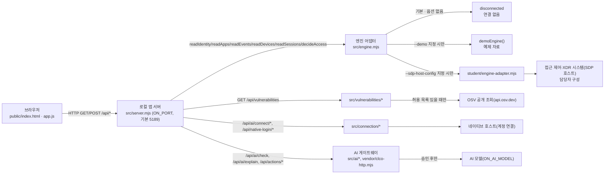

# KESHEV-Cloudy 학생 실행 설명서 (STUDENT_RUNBOOK)

이 문서는 학생(`student/extension.mjs`를 구현한 사람)이 작성했습니다. `README.md`와 `docs/` 아래의 다른 안내 문서는 제공 문서이며 이 문서가 그 내용을 대신하지 않습니다. 이 문서는 "다른 사람이 이 저장소를 받아서 실제로 실행하고, 무엇이 제공 코드이고 무엇이 학생 코드인지 구분할 수 있게" 쓰는 것이 목적입니다.

## 1. 이 프로젝트가 하는 일

케셰브(KESHEV-Cloudy)는 회사 직원이 자기 로그인 상태, 업무 앱 접속 판정, 접속·XDR 기록, AI 연결 상태, AI가 생성한 사건 설명, 보안 조치 상태, 설치 패키지의 알려진 취약점(OSV) 조회 결과를 보는 보안 Agent 화면입니다. 화면은 "제공 공통 UI"(서버·레이아웃·버튼·실제 요청)와 "학생 구현 표시"(`student/extension.mjs`가 그리는 화면)로 분리되어 있습니다. 학생 코드는 결과를 계산하지 않고, 제공 코드가 넘겨준 값을 **해석해서 글로 보여주기만** 합니다. (2026-10-30 변경: `renderStatus` 안의 「내 PC 점검」 구역은 제공 조회 값을 받아 비율과 직전 조회와의 차이를 계산해 보여 줍니다. 자세한 내용은 `docs/STUDENT_DAY2_PC_STATUS.md`.)

## 2. 지원 환경과 버전 (직접 확인함)

- `on-client/package.json`에 기록된 값: 이름 `alekov-client-starter`, 버전 `0.2.21`, `type: module`. 이 문서를 처음 쓸 때(21단계)는 `0.2.11`이었고, 2026-10-30에 제공 업데이트 도구로 `0.2.21`로 올렸습니다. 아래 절차 중 어디까지를 `0.2.21`에서 다시 확인했는지는 `docs/STUDENT_REPRODUCTION_LOG.md` 7절에 구분해 적었습니다.
- Node.js: `package.json`의 `engines.node`는 `24.19.0`. `tools/start-alekov.ps1`은 실행 전 Node 버전을 확인하며, 메이저 버전이 **22~24 범위**를 벗어나면 실행을 중단합니다(파일 안의 `$major -lt 22 -or $major -gt 24` 조건을 직접 읽어서 확인). 24.19.0이 아니면 경고만 띄우고 계속 진행합니다.
- 외부 npm 의존성: 저장소 안에 `package-lock.json`이 **존재하지 않습니다**(직접 `ls`로 확인). `README.md`에도 "외부 npm 의존성이 없다"고 적혀 있고, 코드도 이와 일치합니다. 그래서 `npm install`은 필요하지 않습니다.
- OS: `tools/start-alekov.ps1`은 PowerShell(Windows) 스크립트입니다. 다른 OS에서 PowerShell 없이 실행하는 경로는 이 문서에서 확인하지 않았으므로 **미확인**으로 남깁니다. `node src/server.mjs`로 직접 실행하는 경로는 Linux 환경(이 세션의 작업 공간)에서 직접 실행해 응답을 받은 것까지 확인했습니다.

## 3. 설치·실행 절차 (실제 파일과 대조함)

### 3.1 준비

별도 설치 단계가 없습니다(외부 의존성 없음). 저장소를 받은 뒤 `on-client` 폴더로 이동하면 됩니다.

### 3.2 실행 (둘 중 하나)

**방법 A — 공식 PowerShell 도구(권장, Windows)**

```powershell
cd <저장소 경로>\on-client
powershell -NoProfile -ExecutionPolicy Bypass -File .\tools\start-alekov.ps1
```

- 기본 포트는 `5189`이며, `-Port 5190`처럼 바꿀 수 있습니다(`tools/start-alekov.ps1`의 `param()` 블록에서 확인).
- `-Demo` 스위치를 주면 예제(demo) 자료로 실행됩니다. 주지 않으면 기본은 "연결 안 됨(disconnected)" 상태로 뜨고, 실제 회사 시스템에 연결하려면 `-SdpHostConfig <설정 파일 경로>`를 담당자 안내에 따라 지정해야 합니다.
- 스크립트가 서버 응답(HTTP 200)을 최대 `-WaitSeconds`(기본 20초) 동안 기다린 뒤, 뜨면 `케셰브가 켜졌습니다. 브라우저에서 http://127.0.0.1:<포트>/ 을 여세요.`를 출력합니다. 이 메시지는 **서버가 응답했다는 것만** 확인한 것이고, AI 연결 성공을 뜻하지 않는다고 스크립트 자체에 적혀 있습니다(이 문서도 그 구분을 그대로 따릅니다).

**방법 B — npm 스크립트(직접 node 실행, OS 무관)**

```bash
cd on-client
npm start          # 기본 모드(연결 안 됨)
npm run demo       # 예제(demo) 모드 — 실제 연결이나 성취가 아님
npm run check      # student/extension.mjs 문법만 확인(node --check)
```

이 저장소에서 `node --version`과 `node src/server.mjs --demo` 실행 결과(`케셰브 예제: http://127.0.0.1:5189`가 출력되고 `curl 127.0.0.1:5189`로 HTML 응답을 받음)를 **직접 실행해서 확인**했습니다. 포트는 환경변수 `ON_PORT`(기본 `5189`)로 바꿀 수 있습니다(`.env.example`, `src/server.mjs`에서 확인).

### 3.3 브라우저로 열기

```
http://127.0.0.1:5189/
```

(`-Port`나 `ON_PORT`로 다른 포트를 썼다면 그 번호로 바꿔서 엽니다.)

### 3.4 정상 시작 신호

- PowerShell 도구: `케셰브가 켜졌습니다. 브라우저에서 http://127.0.0.1:<포트>/ 을 여세요.` 출력.
- 직접 `node` 실행: 콘솔에 `케셰브 연결 확인: http://127.0.0.1:<포트>` 또는(`--demo`일 때) `케셰브 예제: http://127.0.0.1:<포트>` 출력(`src/server.mjs`의 `server.listen` 콜백에서 확인).
- 브라우저 화면 맨 위 배지: 예제 모드면 `예제 데이터(demo) · 실제 연결 아님`, 기본 모드(연결 어댑터 없음)면 `연결 없음`이 뜹니다(`public/app.js`의 모드별 배지 문구에서 확인).

### 3.5 종료·재실행

- PowerShell 도구로 켠 경우: 그 창에서 `Ctrl+C`. `-Background`로 켰다면 출력된 프로세스 번호의 `node`를 작업 관리자에서 종료.
- `npm start`/`npm run demo`로 켠 경우: 그 터미널에서 `Ctrl+C`.
- 재실행은 같은 명령을 다시 실행하면 됩니다. 포트가 이미 사용 중이면 PowerShell 도구는 **다른 프로그램을 끄지 않고** 다른 포트 번호를 쓰라고 안내만 합니다(강제 종료 동작 없음을 코드로 확인).

## 4. 구조와 데이터 흐름

### 4.1 글로 쓴 구성도

```
[브라우저]
  (public/index.html, public/app.js, public/vulnerabilities-view.mjs)
    │  HTTP GET/POST  /api/*
    ▼
[로컬 앱 서버]  src/server.mjs  (ON_PORT, 기본 5189)
    │
    ├─ GET /api/me, /api/apps, /api/events, /api/devices, /api/sessions
    │     └─▶ [엔진 어댑터]  src/engine.mjs
    │             ├─ 기본(옵션 없이 실행): disconnected (연결 없음, 아무 기록도 안 줌 — src/engine.mjs의 loadEngine은 경로가 없으면 {evidenceMode:'disconnected'}를 바로 반환)
    │             ├─ --demo 지정 시: demoEngine() (예제 자료, 사건 1건 고정 — src/server.mjs가 demo 플래그일 때만 이 엔진을 고름)
    │             └─ --sdp-host-config 지정 시: student/engine-adapter.mjs
    │                     └─▶ [접근 제어·XDR 시스템(SDP 호스트)] — 담당자가 구성, 학생이 직접 만들지 않음
    │
    ├─ POST /api/access                         → 엔진의 decideAccess (업무 앱 판정)
    ├─ GET  /api/vulnerabilities                 → src/vulnerabilities/*(project-scan.mjs, osv.mjs)
    │                                                  └─▶ [OSV 공개 조회] (api.osv.dev) — 허용 목록 있을 때만
    ├─ POST /api/ai/check, /api/ai/explain       → src/ai/*, vendor/clco-http.mjs
    ├─ POST /api/actions/prepare|execute|result  → src/actions/*
    └─ POST /api/ai/connect/*, /api/native-login/*  → src/connection/*
                                                       └─▶ [AI 게이트웨이 / 네이티브 호스트] — 계정 연결 승인 후에만 동작
```

### 4.2 같은 내용의 Mermaid



실제 파일 경로(`src/server.mjs`, `src/engine.mjs`, `student/engine-adapter.mjs`, `src/vulnerabilities/*`, `src/ai/*`, `src/connection/*`, `vendor/clco-http.mjs`)와 공개 가능한 주소(`http://127.0.0.1:5189`, `api.osv.dev`)만 적었고, 비밀 설정값(열쇠·토큰·개인 SDP 설정 내용)은 적지 않았습니다.

## 5. 제공 부분과 학생 작성 부분

`public/index.html`에 실제로 붙어 있는 라벨을 그대로 옮겼습니다(직접 `grep`으로 확인, 이 문서가 임의로 만든 이름이 아닙니다).

| 화면(탭) | 칸 이름 | 구분 | 담당 함수 |
|---|---|---|---|
| 보호 현황 | 현재 로그인 / 내 기기 / 내 세션 / 도움정보 / AI 연결 / AI 연결 점검 / 설치 패키지와 취약점 정보 | 제공 | — |
| 보호 현황 | 학생 구현 표시 | 학생 | `renderIdentity` (13단계) |
| 보호 현황 | 내 PC 상태 (`0.2.21`에서 새로 생긴 제공 카드, 「내 PC 확인」 버튼) | 제공 | — |
| 보호 현황 | 학생 상태·알림 표시 | 학생 | `renderStatus` (16단계, 2026-10-30에 「내 PC 점검」 구역 추가, 4일차에 「내 PC 점검」이 이 카드 안에서 맨 위로 이동. 카드 자체는 제공 카드 아래의 원래 순서) |
| 보호 현황 | 학생 AI 연결 표시 | 학생 | `renderAiConnection` (17단계) |
| 보호 현황 | 학생 패키지 조회 표시 | 학생 | `renderVulnerabilities` (20단계) |
| 업무 앱 | 접속 요청 / 판정 결과 | 제공 | — |
| 업무 앱 | 학생 구현 표시 | 학생 | `renderDecision` (14단계) |
| 보안 기록 | 접속·XDR 기록 / 조치 준비와 원천 결과 | 제공 | — |
| 보안 기록 | 학생 구현 표시 | 학생 | `renderEvents` (15단계) |
| 보안 기록 | 학생 AI 사건 설명 | 학생 | `renderExplanation` (18단계) |
| 보안 기록 | 학생 조치 상태 표시 | 학생 | `renderAction` (19단계) |

제공 코드 경계: 서버로 보내는 실제 요청(`fetch`/`POST`), 입력 검증(`public/app.js`의 `validExplanation`, `safeActionData`, `public/vulnerabilities-view.mjs`의 `normalizeScan` 등), 서버 상태를 바꾸는 버튼(`AI 설명 요청`, `대상과 조치를 확인했으며 집행합니다` 등)은 전부 제공 코드가 담당합니다. 학생 코드(`student/extension.mjs`)는 화면 조작용 요소(예: `renderEvents`의 종류·업무 앱·접속 상태 필터 셀렉트 3개와 기록별 "상세" 버튼)를 직접 만들 수 있지만, 이 요소들은 **이미 제공 코드가 넘겨준 배열 안에서만 걸러보거나 상세를 펼쳐 보여주는 것**이고, 서버에 새 요청(`fetch`/`POST`)을 보내지 않습니다. 즉 학생 코드가 그릴 수 없는 것은 "화면 요소"가 아니라 "제공 코드를 거치지 않은 새 서버 요청"입니다(17~20단계 전부 이 원칙으로 구현했습니다).

## 6. 확인한 기능 / 오류별 확인 순서 / 미확인 기능

| 함수 | 확인한 상태 (모의 데이터) | 실제 화면에서 확인 | 구조적으로 확인 못 한 부분 |
|---|---|---|---|
| `renderIdentity`/`renderDecision`/`renderEvents`/`renderStatus` | O | O (보호 현황/업무 앱/보안 기록 탭) | 없음 |
| `renderStatus`의 「내 PC 점검」 구역 (2일차) | 오래됨·지원 없음·응답 이상·일부 항목 확인 불가 | 내 PC에서 실제 값 표시, 최근 5번 비교, 서버를 끈 실패 화면 | 내 PC에서의 `확인 불가` 화면 |
| `renderStatus`의 「내 PC 점검」 핵심 3가지·「다시 조회」·오류 화면 (4일차, 코드 커밋 `c92b9e7`. `student/appearance.json`은 4일차 보정 `44a6399`에서 삭제) | 서버 오류·형식 이상·지원 없음·읽을 수 없는 응답·시간 초과 오류 화면(내 화면에 가짜 응답을 넣어 본 것 포함) | 내 PC에서 읽는 중 표시, 가짜 응답 5종과 복구(보정 전 파일), 보정 후 파일로 조회 전·후 화면 순서와 키보드 조회 | 보정 후 파일로 읽는 중 표시·서버를 끈 연결 실패 화면·오류 화면 5종 |
| `renderStatus`의 「연결과 기록」 구역 (3일차) | 방화벽 꺼짐, 일부 항목 못 읽음, 조회 실패, 응답 이상, 서버 모드 알 수 없음 | 내 PC에서 네트워크·방화벽·Windows 경고·오류 표시, `SDP 미연결` 분리 표시, 제공 카드와 값 일치 | 내 PC에서의 `확인 불가` 화면, 예제(demo) 모드 화면 |
| `renderAiConnection` | idle/loading/ok(test·verified)/error 9종 코드 | 실패(`ON_AI_PROVISIONING_PENDING`) 경로만 | 성공(ok) 경로 — 데모 엔진에 `readAiIdentity`가 없어 항상 실패 |
| `renderExplanation` | idle/loading/ok/error, 근거 불일치, 근거 없음, 이미 실행됨 | 실패 경로만 | 성공(ok) 경로 — 위와 같은 이유 |
| `renderAction` | 11개 status 전부 | `idle`만(지원 조치 없는 기록) | prepared~succeeded — 데모 기록에 `supportedActions`가 없음 |
| `renderVulnerabilities` | idle/loading/error/ok(5개 scan status) | `not_configured`만 | complete/partial 등 패키지 목록 — 허용 목록(`ON_APPROVED_PUBLIC_PACKAGES`)이 비어 있음 |

**오류 발생 시 확인 순서**(실제 오류 처리 코드와 연결):
1. 브라우저 화면 위 배지(`예제 데이터(demo)` 등)로 지금 어떤 모드인지 먼저 확인합니다.
2. 제공 칸(`제공` 라벨)에 뜨는 오류 문구를 봅니다 — 코드·메시지가 `public/app.js`의 `ACTION_MESSAGES`/`aiErrorMessages` 등에서 옵니다.
3. 바로 아래 학생 칸이 같은 상태를 다른 말로 설명하는지 봅니다. 학생 칸은 서버 요청을 새로 보내지 않으므로, 재시도는 항상 제공 칸의 버튼으로 합니다.
4. 브라우저 개발자 도구(F12) → Console/Network 탭에서 실제 요청·응답 코드를 봅니다(18단계 작업 중 `POST /api/ai/explain 503` 확인에 실제로 썼던 방법).

**미확인으로 남기는 것** (이 문서 작성 시점 기준):
- Windows가 아닌 OS에서 `tools/start-alekov.ps1` 없이 실행하는 전체 경로.
- 담당자가 `ON_APPROVED_PUBLIC_PACKAGES`·SDP 호스트·AI 앱 권한을 실제로 구성했을 때의 성공 경로 전체(위 표의 "구조적으로 확인 못 한 부분").
- 이 서버를 포트 5189가 아닌 다른 포트로 여러 개 동시에 띄우는 시나리오.

## 7. 지원 범위

- 이 문서는 **예제(demo) 모드와 기본(disconnected) 모드에서 직접 실행하고 확인한 것만** "확인함"으로 적었습니다.
- 실제 회사 시스템(SDP)·실제 AI 모델 연결이 성공했을 때의 동작은 이 문서가 작성된 환경에서 **확인하지 않았으며**, "확인했다"고 적지 않습니다.
- OSV 조회 결과는 알려진 취약점 데이터베이스 조회 결과일 뿐이며, 조회 결과가 없다는 사실만으로 패키지나 앱 전체가 안전하다고 보장하지 않습니다(20단계 작업 시 받은 공식 안내와 동일).

## 8. 개정 기록

- 2026-10-30: 시작 틀 `0.2.21` 반영(2절), `renderStatus`의 「내 PC 점검」 구역과 제공 카드 「내 PC 상태」 구분(1·5·6절). 다른 절(3~4절의 실행 절차·구성도)은 `0.2.11`에서 확인한 내용을 그대로 두었고 `0.2.21`에서 전부 다시 확인하지는 않았습니다. 2일차 내용은 `docs/STUDENT_DAY2_PC_STATUS.md`에 있습니다.
- 2026-10-30: 4일차 화면 다듬기(코드 커밋 `c92b9e7d9aa537c14ea62fda3c11b2c09ebb7c38`). 내용과 확인 결과는 `docs/STUDENT_DAY4_SCREEN_LOG.md`에 있습니다.
- 2026-10-30: 3일차 「연결과 기록」 구역 추가(코드 커밋 `09f9becba11296e40b507682a29cfc66aa2e81e8`). 내용과 확인 결과는 `docs/STUDENT_DAY3_CONNECTION_LOG.md`에 있습니다.
- 2026-10-30: 4일차 보정(코드 커밋 `44a63999123cc0fd18931bfdc023fcb0b75519e1`). 제공 카드와 겹치는 현재 값 표시를 빼고 `student/appearance.json`을 삭제했습니다. 내용과 확인 결과는 `docs/STUDENT_DAY4_SCREEN_LOG.md` 5-0절에 있습니다. 5일차 실행 안내 한 장은 `docs/STUDENT_ONE_PAGE_GUIDE.md`에 있습니다.
